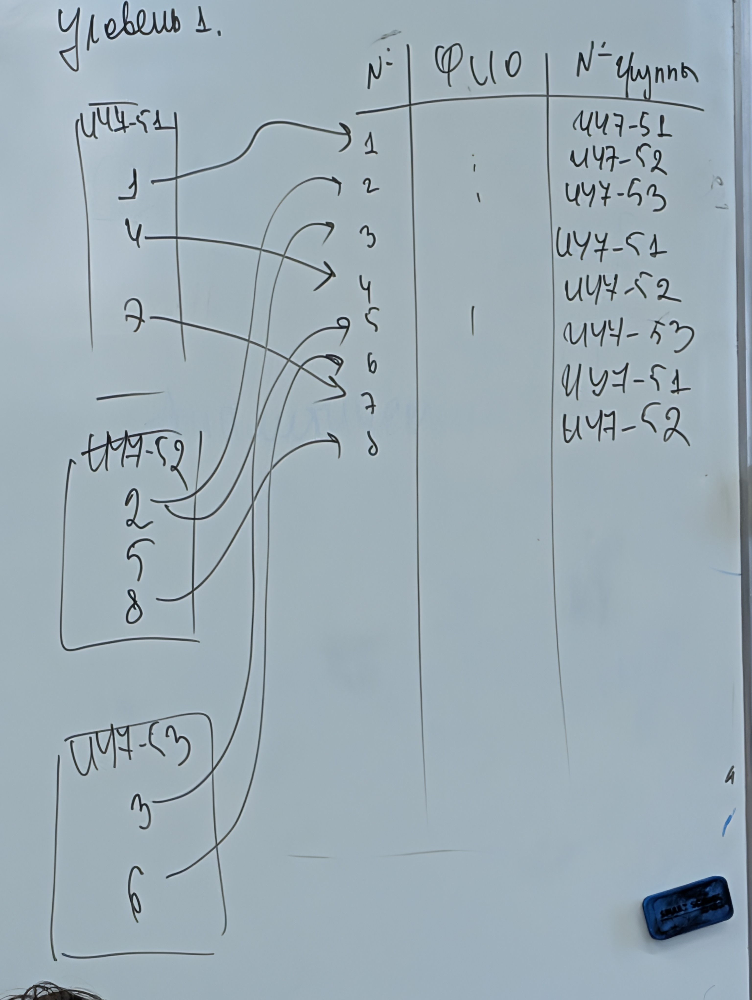
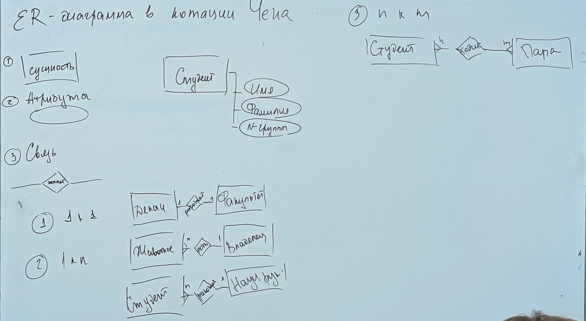
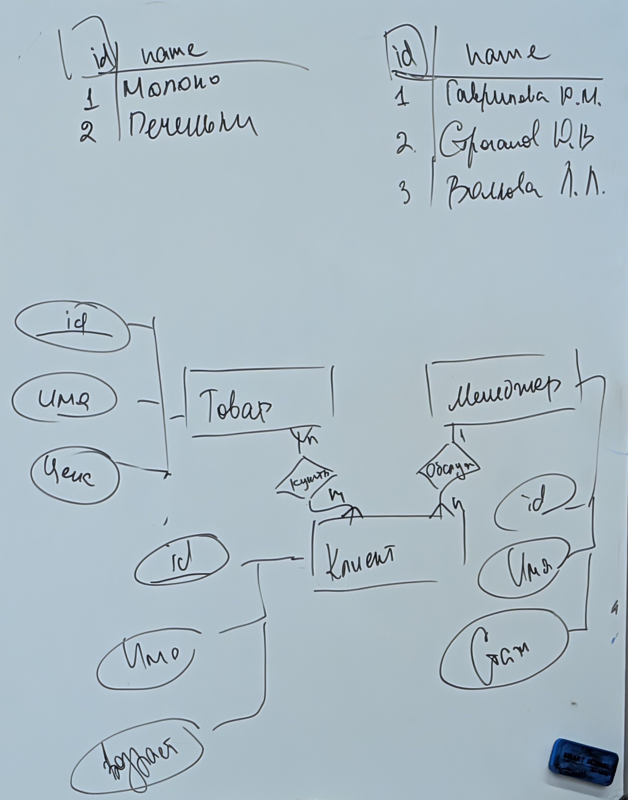
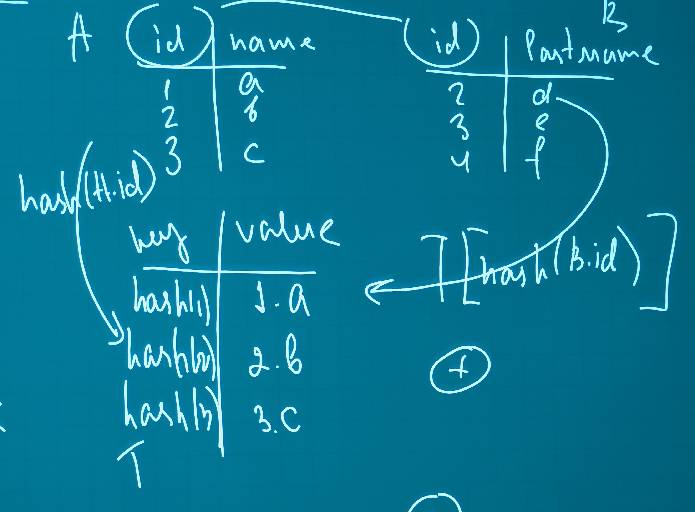
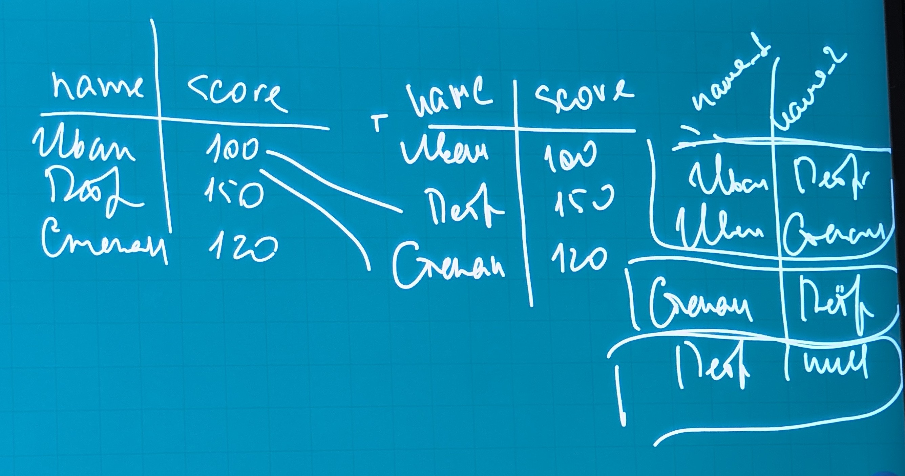
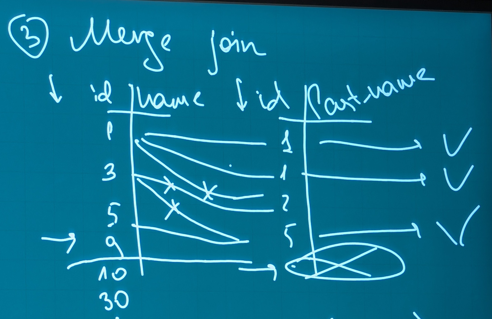
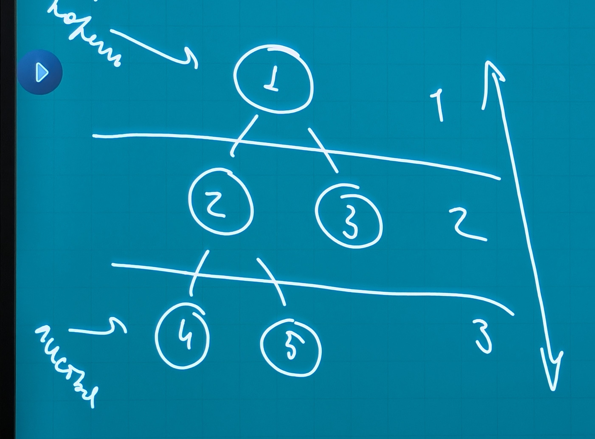

# Преподаватели

Строганов Д.В.
Шибанова Д.А.
Гаврилова Ю.М.

10 лабораторных работ
3 РК
1 Экз

# Закрытие модуля

- min баллов для РК
- сданы ~~10~~ 12 л/р

- Рк1 лекция на ~7 неделе (18-30)б теория + практика
- РК2 семинар (12-20)б практика
- РК3 семинар (12-20)б практика
- ЭКЗ (18-30)б

Стек работы:

- PostgreSQL
- Python или иное (Oracle+java для любителей сложностей)
- DBeaver для работы с несколькими DB

Базу данных можно ставить в docker, но туда же придется добавить Redis и т.д. ...

Концепция баз данных возникла в 60 годах, когда в одном файле хранить уже тяжело а в RAM не влезает.

Мы будем изучать **реляционные** базы данных (таблицы).

**База данных** - самодокументированное собрание интегрированных записей.

- самодокументированное - база данных содержит метки/метаданные, журналы.
- Интегрированные - вместе с метаданными

Требования к БД:

1. Неизбыточность - данные не должны дублироваться без пользы. \*не касается к бэкапов и жулналов.
2. Совместный доступ
3. Эффективность - быстродействие, минимальный отклик
4. Целостность - непротиворечивоть данных. нет висящих ссылок невалидных значений и т.д.
5. Безопасность
6. Восстановление после сбоев.
7. Независимость структур данных от прикладных программ

- БД - база данных - она _хранит_.
- СУБД - Система Управления Базами Данных, она _действует_. Это приложение, которое обеспечивает _работу_ с данными (`хранение`, `обновление`, `поиск`).

**Основные функции СУБД**:

1. Управление данными во внешней памати
2. Управление данными в оперативной памяти (буферы, кэши и т.д.)
3. Управление транзакциями
4. Журналирование
5. Поддержка языка (SQL)

**SQL** - Structured Query Lauguage. Еще и стандарт с 2011 года. Любая база данных должна их поддерживать.

В рамках курса мы изучим:

- SQL
- Реляционную модель
    - Теория множеств
    - Логика предикатов
- Потом PlpgSQL

SQL:

1. DDL (Data Definition Language) -> про объекты
    - создать `create`
    - удалить `drop`
    - изменить `alter`
2. DML (Data Manipulation Language) -> про данные
    - получить `select`
    - добавить `insert`/`copy`
    - удалить `delete`
    - очистить `truncate`
    - изменить `update`
3. DCL (Data Control Language) -> про права
    - выдать `grant`
    - отозвать `revoke`
    - запретить `deny`

# DDL

| a1  | a2  | a3  |
| :-: | :-: | :-: |
|  1  |  2  |  3  |
|  4  |  5  |  6  |
|  7  |  8  |  9  |

~~Столбец~~ -> Атрибут\
~~Строка~~ -> Кортеж\
~~Таблица~~ -> Отношение\
У ~~столбцов~~ нет номеров\
{1, 1, 2} = {1, 2}\
{2, 1} = {1, 2}

Множество всех ~~столбцов~~ - заголовок \
Множество всех ~~строк~~ -> тело отношения

## Способы хранения данных

1. Таблица `table`
2. Временная таблица `temp table`
3. Представление `view` - хранит не данные а запросы, поэтому при образении к `view` оно превращается в другие запросы.
4. Материлизованное представление `materialised view`.
5. Табличная переменная, создать через `declare`.
6. Индексированное представление `index`.

```sql
create table [БД,][схема.]имя_таблицы (             -- public.table1
    <имя_атрибута тип_атрибута [ограничения][,]>+
    [ограничеие на таблицу]
)
[способы хранения данных]
;
```

| OLTP - OnLine Transaction Processin | OLAP - OnLine Analythical Processing                        |
| ----------------------------------- | ----------------------------------------------------------- |
| Операционные данные                 | Перманетные данные <br> (аналитические, децентрализованные) |
| t_write/insert/delete -> min        | t_select -> min                                             |
| 3НФ                                 |                                                             |

Часто типы хранения вложены для компромиса

БД включает в себя и аппаратное и программное обеспечение.
СУБД - программное обеспечение для высокоуровневого оперирования данными.
В БД есть пользователи:

- Администраторы
- Не привилегированные пользователи (люди/программы)

Классификация баз данных

1. По модели храниия:
    - Дореляционные модели
        - Инвертированные списки 
        - Иерархические модели
        - Сетевая модель
    - Реляционная модель
    - Постреляционные модели
2. По архитектуре организации данных
    - Локальная `postgres`, `oracle`, `mssql` ...
    - Распределенная `vertica`, `greenplum`, `clickhouse` ...
3. По способу доступа
    - Файл-серверная архитектура
        - Microsoft Access
        - Excel
    - Клиент-серверная архитектура - клиент делает запрос, бд возвращает в ответ ровно столько, сколько запрошено. `postgreSQL`, `oracle`, `mssql` ...
    - Встраиваемые СУБД - библиотека. `REDIS`, `sqLite` ...
    - Сервисо-ориентированные БД - оспользуется для коммуникаций между приложениями и т.д. `Kafka`, `RabbitMQ`
    - Прочие.

## Нотация Чена

ER - Entiti-Relationship. Сущность-связь \



# Физические соединения

1. Nested loops join \
    ```
    for i...
        for j...
        if (<предикат>):
            true
        else:
            false
    ```
    \+ Простая логика \
    \- O(n\*m) большая асимптотика алгоритма
2. Hash join\
   В хэш загружается меньшая по размеру таблица - так проще разместить в ram. \
   `B left join A` \
    
   \+ - O(m) + O(n) \
    \- дополнительная память \
    \- Пригодно только для поиска по `=` в условии \
    **Пример:** \
    На каком месте находится спортсмен?
   
    ```sql
      SELECT s1.name, count(s2.name) + 1 as position
      FROM sports s1 LEFT JOIN
           sports s2
           ON s2.score > s1.score
      GROUP BY s1.name
    ```
3. Merge join
    \
   \+ O(n+m) \
   \- O(nlog(n)) x2 на предварительную сортировку, если она нужна

**Задача:** Найти все цвета, в которые входят макс. количество деталей

1. group by -> count(\*)
2. max -> 2
3. cnt = max

```sql
SELECT color, count(*) as cnt
FROM p
GROUP BY color
HAVING count(*) = (
    SELECT max(cnt) as m
    FROM (
        SELECT color, count(*) as cnt
        FROM p
        GROUP BY color as t
    )
)
```

ОТВ/CTE

```sql
WITH имя_отв_1(<атрибуты>) AS (
    SELECT запрос...
), имя_отв_2 AS (
    SELECT запрос...
)
sql-запрос;
```

```sql
WITH grouped AS (
    SELECT color, count(*) as cnt
    FROM p
    GROUP BY color
)
SELECT *
FROM grouped
WHERE cnt = (
    SELECT max(cnt)
    FROM grouped
)
```

---

| id  |  name  | m_id | e2_name | e2 name |
| :-: | :----: | :--: | :-----: | :-----: |
|  1  |  Иван  | null |  null   |  null   |
|  2  |  Петр  |  1   |  Иван   |  null   |
|  3  | Мария  |  1   |  Иван   |  null   |
|  4  | Степан |  2   |  Петр   |  Иван   |
|  5  | Ольга  |  2   |  Петр   |  Иван   |



```sql
SELECT *
FROM empl e1 LEFT JOIN empl e2
    ON e1.m_id = e2.id
    LEFT JOIN empl e3
    ON e2.m_id = e3.id
```

```sql
WITH RECURSIVE otv( id, name, m_id, level) AS (
    SELECT id, name, m_id, 0 as level
    FROM empl
    WHERE m_id IS NULL
    UNION ALL
    SELECT e.id, e.name, e.m_id, o.level+1 FROM otv o JOIN empl e
        ON e.m_id = o.id
)
SELECT max(level)
FROM otv
```

| id  |  name  | m_id | level |
| :-: | :----: | :--: | :---: |
|  1  |  Иван  | null |   0   |
|  2  |  Петр  |  1   |   1   |
|  3  | Мария  |  1   |   1   |
|  4  | Степан |  2   |   2   |
|  5  | Ольга  |  2   |   2   |

# Оконные функции

```sql
имя_ф(параметры) over(partition by атрибут
                        order by атрибут)
```

## Классификация:

1. Ранжирующие оконные функции
    - row number
    - rank
    - dense_rank
2. Аггрегатные оконные функции
    - sum
    - max
    - min
    - count
3. Функции смещения
    - lead
    - laq
    - first_value
    - last_value

| Pno | P_name | Color | Weight |  City  | rn1 | rn2 | rn3 | rn4 |  s1  |  s2  |  s3  |  s4  |  l1  |  l2  |
| :-: | :----: | :---: | :----: | :----: | :-: | :-: | :-: | :-: | :--: | :--: | :--: | :--: | :--: | :--: |
|  1  | Гвоздь |   k   |  10.5  | Москва |  1  | 2/3 |  2  |  2  | 52.8 | 29.9 | 52.8 | 10.5 |  0   | 11.3 |
|  2  |  Винт  |   k   |  11.3  |  Тула  |  2  |  4  |  4  |  3  | 52.8 | 29.9 | 42.3 | 21.8 | 10.5 | 8.1  |
|  3  | Шуруп  |   k   |  8.1   | Рязань |  1  |  1  |  1  |  1  | 52.8 | 29.9 |  31  | 8.1  | 11.3 | null |
|  4  | Шайба  |   c   |  10.5  |  Тула  |  1  | 2/3 |  2  |  2  | 52.8 | 22.9 | 22.9 | 10.5 |  0   | 12.4 |
|  5  | Гайка  |   c   |  12.4  | Москва |  2  |  5  |  5  |  5  | 52.8 | 22.9 | 12.4 | 22.9 | 10.5 | null |

```sql
select *,   row_number() over(partition by City order by Weight)        rn1,
            row_number() over(order by Weight)                          rn2,
            rank() over(order by Weight)                                rn3,
            dense_rank() over(order by Weight)                          rn4,
            sum(Weight) over()                                          s1,
            sum(Weight) over(partition by Color)                        s2,
            sum(Weight) over(order by Pno desc)                         s3,
            sum(Weight) over(partition by City order by Weight)         s4,
            laq(Weight, 1, 0) over(partition by Color order by Pno)     l1,
            lead(weight) over(partition by Color order by Pno)          l2,
from p
```

**scd0** - нет логов изменений \
**scd1** - есть лог всех изменений

|  №  |         | value |
| :-: | :-----: | :---: |
|  1  | Ромашка |  20   |
|  1  | Ромашка |  30   |

**scd2**

|  №  |         | value |    from    |    now     |
| :-: | :-----: | :---: | :--------: | :--------: |
|  1  | Ромашка |  20   | 01.01.1990 | 28.09.2026 |
|  1  | Ромашка |  30   | 29.09.2026 | 31.12.9999 |

Пример таблицы

|  №  |     dt     | time  | type |
| :-: | :--------: | :---: | :--: |
|  1  | 29.09.2026 | 9:15  |  1   |
|  1  | 29.09.2026 | 10:10 |  0   |
|  1  | 29.09.2026 | 10:30 |  1   |
|  1  | 29.09.2026 | 19:05 |  0   |
|  2  | 29.09.2026 | 10:30 |  1   |
|  2  | 29.09.2026 | 17:25 |  0   |
|  1  | 30.09.2026 | 9:30  |  1   |
|  1  | 30.09.2026 | 19:30 |  0   |

```sql
select dt, id
from kpp
where time < '19:00:00'::time
group by id, dt
having (count(*) % 2) = 1
```

```sql
select *, from(
    select *, row_number() over(partition by id, dt order by time desc) m
    from kpp
    where time < '19:00:00'::time
)
where m = 1
```
